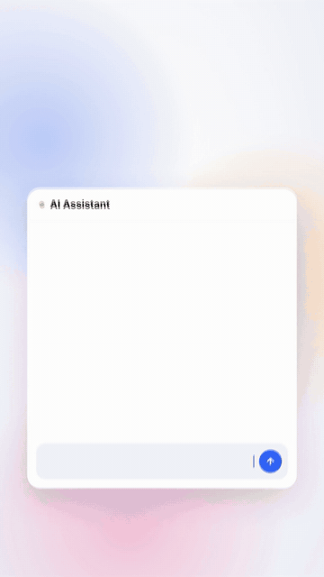

# Reel Scroll 1.0

<p align="center">
  <a href="media/reel-scroll-promo.mp4">
    
  </a>
  <br>
  <a href="media/reel-scroll-promo.mp4"><b>▶ Watch the full 44-second video (with sound)</b></a>
</p>

<video src="media/reel-scroll-promo.mp4" poster="media/poster.jpg" controls muted width="360"></video>

Productive scrolling. Your Instagram Reels unlock only while Claude is thinking, and lock the moment the answer lands.

- **You send Claude a message:** the Claude app's built-in browser jumps to your Instagram Reels, with a "Claude is thinking · 12s" pill at the top of the screen.
- **Claude finishes:** the video pauses and mutes, and a lock screen shows how long you scrolled and how many reels you watched. Scrolling and clicks are blocked until your next message.
- **Login pages are never locked**, so signing in or two-step verification always works.

## Where it works

Reel Scroll is a plugin with hooks, and Claude only runs plugin hooks in **Claude Code** (the desktop app's **Code** tab, the terminal, IDE extensions) and in **Cowork** tasks. The plain **Chat** tab, and claude.ai in the browser, ignore plugin hooks, so Reel Scroll cannot run there. Start a Code or Cowork session in the Claude desktop app to use it.

### Chat skills: `/enable-reels` and `/disable-reels`

For plain Chat there are two skills. Run `/enable-reels` once in a chat and Reel Scroll unlocks the reels in the built-in browser while Claude works on each reply, then locks them when the answer is ready. `/disable-reels` turns it off for that chat.

**Download:** [`reel-scroll-skills.zip`](https://github.com/Omar-Raslan-16006931/reel-scroll/raw/main/downloads/reel-scroll-skills.zip) (both skills), or one at a time: [`enable-reels.zip`](https://github.com/Omar-Raslan-16006931/reel-scroll/raw/main/downloads/enable-reels.zip), [`disable-reels.zip`](https://github.com/Omar-Raslan-16006931/reel-scroll/raw/main/downloads/disable-reels.zip).

**Install:** in the Claude app open **Customize > Skills**, choose **Upload skill**, and pick a zip (upload `enable-reels.zip` and `disable-reels.zip` separately if the app takes one skill per file). The skill sources are in [`skills/`](skills).

Needs the Claude desktop app's built-in browser and a one-time Instagram sign-in. Skills are instructions, so Claude makes the unlock and lock calls itself around each reply.

### Plain claude.ai chat

Chat can't run plugins, so there is a Chrome extension for it: [`claude-ai-extension`](claude-ai-extension/README.md). Load it unpacked in Chrome and Reel Scroll works in every claude.ai chat.

## Install

In the Claude desktop app: click **+** next to the prompt box, then **Plugins**, **Add marketplace** with `Omar-Raslan-16006931/reel-scroll`, then **Add plugin**.

In a Claude Code terminal session:

```
/plugin install reel-scroll --marketplace Omar-Raslan-16006931/reel-scroll
```

Answer `y` to add the marketplace, then pick the **user** scope so it runs in every session.

From a shell:

```
claude plugin install reel-scroll --marketplace Omar-Raslan-16006931/reel-scroll
```

## First run

1. Open the built-in browser in the Claude desktop app (Cmd+Shift+B on Mac, Ctrl+Shift+B on Windows).
2. Go to instagram.com and sign in once. The sign-in is kept for later sessions.
3. Send Claude anything. Reels unlock.

Reel Scroll needs the Claude desktop app open, because the reels play in its built-in browser. `/reels` opens a small panel with built-in demo reels if you want to try it without Instagram.

## Commands and settings

(Named `/reels-on` and `/reels-off` so they never clash with the `/enable-reels` skill for Chat.)

- `/reels-on` turns Reel Scroll on for the current chat and asks for the one-time instagram.com approval right then.
- `/reels-off` turns it off for the current chat.
- `/reels` opens the demo-reels panel.
- **Where it runs** (plugin setting): `auto` (default) runs in every chat. `chat` runs only in chats where you ran `/reels-on`.

## Not running in a chat?

- Run `/reels-on` in that chat. It also grants the Instagram approval.
- **Install for every session:** when asked for a scope, pick **user**. Project or local scope only works in that one project.
- **Chats already open don't pick it up.** Start a new chat, or run `/reload-plugins`.
- **Approve Instagram once.** The built-in browser asks before a chat may use instagram.com. Reel Scroll requests it for you; choose "allow for this site" so new chats don't ask again.
- **Update:** `claude plugin update reel-scroll`, then `/reload-plugins`.
- The Claude desktop app has to be open and online, because the reels play in its built-in browser.

Not affiliated with Instagram or Meta.
